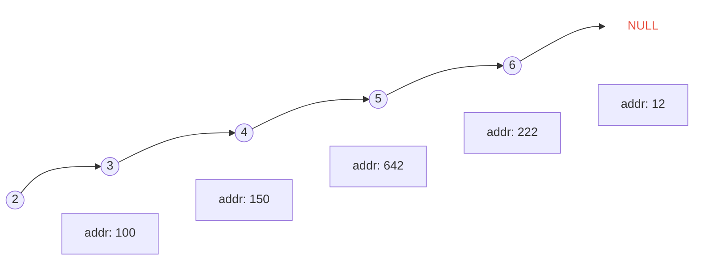

### Linked List


> **定义一个链表类型**
```c
typedef struct _node{
	int value;          //数据域
	struct _node *next; // 指针域
} Node;
```
### Singly Linked List



```c
int main(int argc, char const* argv[] ){
    Node * head = NULL;
    int num;
    do{
        scanf("%d",&num);
        if(num != -1){
            Node *p = (Node*)malloc(sizeof(Node));
            p->value = num;
            p->next = NULL;

            Node *last = head;
            if(last){
                while (last -> next){
                    last = last -> next;
                }
            //attach
                last->next = p;
            }
        }
    } while (num != -1);
    return 0;
}
```


